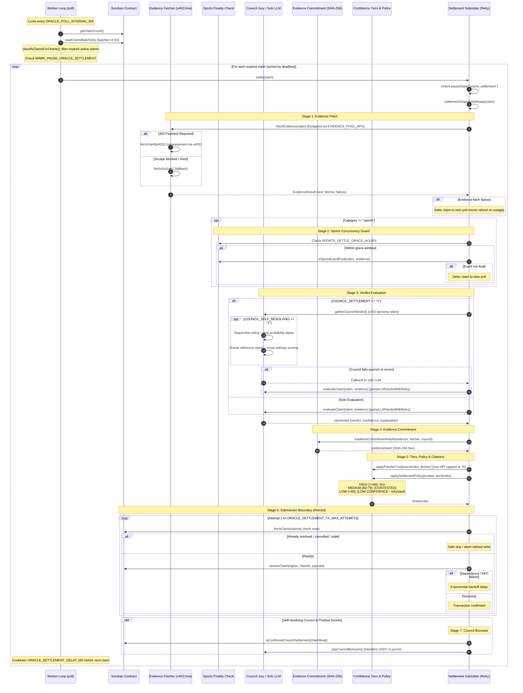

# Oracle Settlement Pipeline

This document describes how an expired prediction market claim transitions from expired (`active` with `deadline <= now`) to settled (`resolved`) on Stellar Soroban in Mimir.

For transaction incident handling and operator rollback, see [`AGENT_INCIDENT_RUNBOOK.md`](AGENT_INCIDENT_RUNBOOK.md).
For evidence hash commitment layout and verification, see [`EVIDENCE_COMMITMENT.md`](EVIDENCE_COMMITMENT.md).

---

## Table of Contents

- [Architecture Overview](#architecture-overview)
- [End-to-End Sequence Diagram](#end-to-end-sequence-diagram)
- [Detailed Pipeline Stages](#detailed-pipeline-stages)
  - [1. Poll & Claim Classification](#1-poll--claim-classification)
  - [2. Pre-Settlement Lifecycle Guards](#2-pre-settlement-lifecycle-guards)
  - [3. Evidence Retrieval & Budgeting](#3-evidence-retrieval--budgeting)
  - [4. Sports Finality & Grace Window](#4-sports-finality--grace-window)
  - [5. Verdict Generation (Solo vs. Council)](#5-verdict-generation-solo-vs-council)
  - [6. Canonical Evidence Commitment](#6-canonical-evidence-commitment)
  - [7. Fetcher Trust & Confidence Tiering](#7-fetcher-trust--confidence-tiering)
  - [8. Settlement Policy & Research Citations](#8-settlement-policy--research-citations)
  - [9. On-Chain Submission & Bounded Retry](#9-on-chain-submission--bounded-retry)
  - [10. Post-Settlement Council Bonuses](#10-post-settlement-council-bonuses)
- [Failure Handling Matrix](#failure-handling-matrix)
- [Environment Configuration Knobs](#environment-configuration-knobs)

---

## Architecture Overview

The settlement pipeline spans the following modules:

| Component | Path | Responsibility |
|---|---|---|
| **Oracle Worker** | `agents/oracle/index.ts` | Polling loop, claim batching, sports finality check, settlement orchestration, cooldown timing. |
| **Evidence Fetcher** | `lib/server/evidence-fetcher.ts` | SSRF-validated web evidence retrieval with CoinGecko API routing, direct fetch, x402 payment, and Jina fallback. |
| **Verdict Parser** | `lib/verdict-parser.ts` | Strict JSON schema parsing of LLM output with two-attempt retry nudge. |
| **Council Consensus** | `agents/oracle/council-vote.ts` | Optional multi-agent persona jury consensus and sequential self-resolving scoring mechanism. |
| **Evidence Commitment** | `lib/evidence-commitment.ts` | Canonical length-framed byte encoding (v1) and SHA-256 digest computation (`evidence_hash`). |
| **Confidence Tiers** | `lib/oracle/confidence-tiers.ts` | Pure confidence tier thresholds (HIGH ≥ 80, MEDIUM 60–79 with `[CONTESTED]`, LOW < 60 refund) and non-API confidence capping at 75. |
| **Unresolvable Policy** | `lib/oracle/unresolvable-policy.ts` | Explicit outcome determination (`firm`, `contested`, `draw`, `refund` with typed reasons). |
| **Settlement Retry** | `lib/settlement-retry.ts` | Pure error classification (`malformed`, `stale`, `duplicate`, `cancelled`, `paused`, `dependency-failure`) and exponential backoff retry. |
| **Soroban Contract** | `contracts-soroban/mimir-market` | On-chain state transition to `resolved`, winner recording, and escrowing challenger payouts for pull-based redemption. |

---

## End-to-End Sequence Diagram

The sequence below matches the exact code execution order in `agents/oracle/index.ts`:

---

## Detailed Pipeline Stages

### 1. Poll & Claim Classification
The worker loop in `agents/oracle/index.ts:830` polls every `ORACLE_POLL_INTERVAL_MS` (default `60000` ms).
- **Claim Batching:** Fetches total claim count via `getClaimCount()` and batches RPC reads in chunks of 50 via `readClaimsBatch(ids)`.
- **Classification:** `classifyClaimsForOracle` filters claims into `expiredActive` (`state === "active"` and `deadline <= now`) and `challengeable` (`state === "open"`).
- **Pre-Settlement Pause Check:** If `isPaused("oracle_settlement")` (`MIMIR_PAUSE_ORACLE_SETTLEMENT=1` or `MIMIR_PAUSE_ALL=1`), the loop clears the `expiredActive` queue immediately. No LLM queries, evidence purchases, or transactions occur.
- **Deadline Sorting:** `expiredActive` claims are sorted in ascending order of deadline (`a.deadline - b.deadline`) so older expired claims settle first.
- **Inter-Settlement Delay:** After resolving a claim, the loop waits `ORACLE_SETTLEMENT_DELAY_MS` (default `900000` ms / 15 minutes) before proceeding to the next claim to avoid transaction congestion.

### 2. Pre-Settlement Lifecycle Guards
Before any computation or network requests, `settle(claim)` runs lightweight sanity checks:
- **Operator Pause:** `pauseState("oracle_settlement")` gates execution.
- **Terminal States:** If `claim.state === "resolved"` or `"cancelled"`, settlement is a no-op.
- **Staleness Check:** `settlementSnapshotIsReady(claim, nowSecs)` verifies that `claim.state === "active"` and `claim.deadline <= nowSecs`.

### 3. Evidence Retrieval & Budgeting
`fetchEvidence(claim)` in `lib/server/evidence-fetcher.ts` obtains the source content for the claim's `resolution_url`:
- **SSRF Defense:** `validateHop` checks the URL against private IP ranges and local hostnames via `domainPolicyFromEnv()`.
- **Evidence Spending Budget:** If `PAY_EVIDENCE !== "0"`, the oracle calculates an evidence budget based on `EVIDENCE_POOL_BPS` (default `50` bps = 0.5% of total pot), bounded between `EVIDENCE_MIN_USDC` (default `0.001` USDC) and `EVIDENCE_MAX_USDC` (default `0.05` USDC).
- **Host Routing:**
  - `coingecko.com`: Handled by `fetchCoinGeckoSnapshot` (`fetcher: "coingecko-api"`).
  - General URLs: `tryDirectFetch` attempts direct HTTP GET (following max 5 redirects with manual hop validation).
  - HTTP 402 Payment Required: If a source requires payment and `paidFetch` is provided, `fetchViaHttp402` pays with a budgeted USDC transfer (`fetcher: "bot-paid"`).
  - Cloudflare / Scraped Fallback: If blocked by bot protection or if content is under 200 characters, falls back to Jina Reader (`https://r.jina.ai/URL`) (`fetcher: "jina"`).
- **Outage Protection:** If evidence retrieval fails, `evidence.failure` is set. The oracle defers the claim to the next poll. **A fetch failure is never converted into an on-chain refund.**

### 4. Sports Finality & Grace Window
Sports markets close betting at match kickoff, meaning the claim deadline is in the past while the match is still in progress:
- **Grace Window Calculation:**
  $$\text{Grace Period} = \max(1, \text{SPORTS\_SETTLE\_GRACE\_HOURS} \times 3600)$$
  Defaults to 12 hours (`SPORTS_SETTLE_GRACE_HOURS`).
- **Finality Check:** While $\text{now} \le \text{deadline} + \text{grace}$, the oracle queries the LLM via `isSportsEventFinal(claim, evidence.text)`:
  - If the match is not definitively finished (`final: false`), settlement is deferred to a future poll.
  - If $\text{now} > \text{deadline} + \text{grace}$, the grace window has expired. The oracle proceeds with settlement to prevent permanently locked funds during extended data outages.

### 5. Verdict Generation (Solo vs. Council)
Depending on `COUNCIL_SETTLEMENT`:
- **Council Mode (`COUNCIL_SETTLEMENT=1`):**
  - Calls `gatherCouncilVerdict` pointing to `COUNCIL_BASE_URL` (`MIMIR_BASE_URL`), buying persona verdicts up to `COUNCIL_VOTE_CAP_USDC` per vote.
  - Personas are filtered by category.
  - **Quorum Gate:** Evaluated with `COUNCIL_QUORUM` (default `3`). If quorum is not met or votes fail, it safely falls back to solo evaluation.
  - **Self-Resolving Jury (`COUNCIL_SELF_RESOLVING=1`):**
    - Jurors report sequentially in random order seeing previous reports (`qHistory`).
    - After reaching `minVotes`, the jury randomly terminates with probability `COUNCIL_ALPHA` (default `0.25`).
    - The oracle produces a terminal reference evaluation seeing the full juror history.
    - Juror reports are scored with a cross-entropy scoring rule against the terminal reference probability.
- **Solo Evaluation (Default or Fallback):**
  - `evaluateClaim(claim, evidence)` formats prompt with security fences (`INJECTION_GUARD`, `fenceUntrusted`).
  - Calls `throttledLLM` gated by `ORACLE_LLM_THROTTLE_MS` (default `8000` ms) to satisfy provider RPM limits.
  - Passes `VERDICT_LLM_SCHEMA` for native structured JSON output.
  - Uses `parseLLMVerdictWithRetry`: if Attempt 1 fails to parse, retries once with `VERDICT_RETRY_SUFFIX`. If both fail, throws to defer to the next poll cycle.

### 6. Canonical Evidence Commitment
`evidenceCommitmentHash` in `lib/evidence-commitment.ts` produces the deterministic `evidence_hash` written to chain:
- **Canonical Byte Layout (Version 1):**
  - Length-framed header (`version:1`, `fetcher:<kind>`, `source:<url>`, `bytes:<n>`).
  - ASCII record separators (`0x1e`) framing the exact UTF-8 evidence body.
  - Canonical council record (`tally`, `qChain`, `referenceQ`, `scores`) or `"none"`.
- **Validation:** Enforces maximum body size (64 KiB), rejects unpaired UTF-16 surrogates, and validates freshness (`MAX_EVIDENCE_AGE_MS` = 15 minutes).
- **Digest:** SHA-256 bare lowercase 64-character hex string.

### 7. Fetcher Trust & Confidence Tiering
In `lib/oracle/confidence-tiers.ts`:
- **Fetcher Trust Cap:** `applyFetcherTrust` caps confidence at `MAX_CONFIDENCE_NON_API` (`75%`) for non-API evidence (`jina`, `direct`, `none`). Scraped HTML can never reach the HIGH tier.
- **Confidence Tiers:**
  - **HIGH (Confidence $\ge 80$):** Settles decisive outcome (`CREATOR_WINS` or `CHALLENGERS_WIN`).
  - **MEDIUM ($60 \le \text{Confidence} < 80$):** Settles decisive outcome with `[CONTESTED]` tag prefixed to summary.
  - **LOW (Confidence $< 60$):** Converted to `UNRESOLVABLE` with `[LOW CONFIDENCE — refunded]` tag. The contract returns all stakes with zero fees.

### 8. Settlement Policy & Research Citations
- **Settlement Policy:** `applySettlementPolicy` in `lib/oracle/unresolvable-policy.ts` assigns typed outcomes:
  - `firm`: High confidence decisive verdict.
  - `contested`: Medium confidence contested verdict.
  - `draw`: `DRAW` verdict pass-through.
  - `refund`: Model-initiated `UNRESOLVABLE`, tier-forced `low-confidence`, or `invalid-confidence` (non-finite or out-of-range confidence).
- **Research Citations:** Attaches validated canonical citation for `resolution_url` and up to `MAX_VERDICT_CITATIONS` (3) citations from LLM payload.

### 9. On-Chain Submission & Bounded Retry
`submitSettlementWithRetry` executes the funded contract call with dedicated isolation:
- **Fresh State Refresh:** Re-reads `fetchClaim(claimId)` before every attempt.
- **Lifecycle Conflict Avoidance:** If chain state changed to `resolved` or `cancelled`, returns immediately without a write.
- **Contract Call:** Signs and submits `resolveClaim(ORACLE.signer, claimId, payload)`.
  - Maps verdict to contract enum: `"creator"`, `"challengers"`, `"draw"`, or `"unresolvable"`.
  - Soroban transitions state to `resolved` and escrows challenger payout for pull-based redemption via `claim_challenger_payout`.
- **Error Classification & Backoff:** `classifySettlementError` categorizes errors:
  - `malformed`, `stale`, `duplicate`, `cancelled`, `paused`: Non-retryable; stops immediately.
  - `dependency-failure`: Retries up to `ORACLE_SETTLEMENT_TX_MAX_ATTEMPTS` (default `3`) using exponential backoff starting at `ORACLE_SETTLEMENT_TX_RETRY_BASE_MS` (default `1000` ms) up to `ORACLE_SETTLEMENT_TX_RETRY_MAX_MS` (default `15000` ms). If exhausted, defers to next poll.

### 10. Post-Settlement Council Bonuses
If self-resolving council was used and `COUNCIL_BONUS_USDC` > 0:
- Verifies on-chain resolution via `isConfirmedCouncilSettlement` comparing normalized `evidence_hash`.
- Reserves bonus transfers in `lib/council-bonus-ledger.ts`.
- Calls `payCouncilBonuses` to transfer USDC from the oracle wallet to jurors who achieved positive cross-entropy scores.
- Failure of bonus transfers does not affect the already-final settlement.

---

## Failure Handling Matrix

| Failure Point | Classification | Action Taken | On-Chain Impact |
|---|---|---|---|
| Operator pause active | `paused` | Defer without fetching evidence, querying LLM, or signing | None |
| Evidence URL unreachable / 5xx / timeout | `dependency-failure` | Defer claim to next poll cycle | None |
| Cloudflare bot interstitial | — | Fall back to Jina Reader markdown extraction | None |
| Sports event in progress (< grace window) | — | Defer claim to subsequent poll cycle | None |
| LLM structured output invalid / unparseable | `malformed` | Retry once with `VERDICT_RETRY_SUFFIX`; if still invalid, throw and defer | None |
| Evidence contains lone surrogate / > 64 KiB | `invalid_encoding` / `evidence_too_large` | Commitment throws; settlement aborts, retried next poll | None |
| Model confidence < 60% | `low-confidence` | Rewrite verdict to `UNRESOLVABLE` with `[LOW CONFIDENCE — refunded]` | Full refund to all stakers |
| Non-finite or invalid confidence (e.g. NaN) | `invalid-confidence` | Rewrite verdict to `UNRESOLVABLE` with `[LOW CONFIDENCE — refunded: invalid confidence]` | Full refund to all stakers |
| Claim already resolved on-chain | `duplicate` | Skip; log duplicate avoided | None (idempotent) |
| Claim cancelled on-chain | `cancelled` | Skip; no settlement submitted | Contract refunds stakers |
| Soroban RPC timeout / network failure | `dependency-failure` | Bounded exponential retry (up to max attempts), then defer to next poll | None until confirmed |

---

## Environment Configuration Knobs

Every environment variable read directly or indirectly by `agents/oracle/index.ts`:

| Environment Variable | Default | Purpose & Description |
|---|---|---|
| `ORACLE_SECRET` | *(required)* | Stellar secret seed (`S…`) used to sign `resolveClaim` and `challengeClaim` transactions. |
| `NEXT_PUBLIC_STELLAR_MARKET_CONTRACT_ID` | *(required)* | Contract ID (`C…`) of the Soroban prediction market contract. |
| `ORACLE_GEMINI_API_KEY` | *(optional)* | Worker-scoped Gemini API key. When set, promoted to `GEMINI_API_KEY` for the oracle process. |
| `GEMINI_API_KEY` | *(optional)* | Google Gemini API key used for verdict evaluation and sports finality prompts. |
| `ANTHROPIC_API_KEY` | *(optional)* | Anthropic API key used as fallback LLM provider. |
| `GROQ_API_KEY` | *(optional)* | Groq API key used as fallback LLM provider. |
| `GROQ_API_KEYS` | *(optional)* | Comma-separated Groq API keys for rotation. |
| `OPENROUTER_API_KEY` | *(optional)* | OpenRouter API key used as fallback LLM provider. |
| `ORACLE_POLL_INTERVAL_MS` | `60000` | Worker poll cadence in milliseconds (default 60 seconds). |
| `ORACLE_LLM_THROTTLE_MS` | `8000` | Minimum milliseconds between consecutive LLM calls to respect free-tier RPM limits. |
| `ORACLE_SETTLEMENT_DELAY_MS` | `900000` | Cooldown in milliseconds between successive claim settlements in the same poll (default 15 minutes). |
| `AUTO_CHALLENGE` | `0` | Enable oracle auto-challenger role (`1` to enable, default off). |
| `CHALLENGE_STAKE_USDC` | `2` | Base stake in USDC for auto-challenging mispriced open claims. |
| `CHALLENGE_CONFIDENCE` | `80` | Minimum confidence score (0–100) required for the oracle to challenge a claim. |
| `PAY_EVIDENCE` | `1` | Enable x402 paid evidence fetching (`0` to disable). |
| `EVIDENCE_POOL_BPS` | `50` | Basis points of claim pot allocated to evidence budget (50 bps = 0.5%). |
| `EVIDENCE_MIN_USDC` | `0.001` | Minimum floor budget in USDC for paid evidence fetching. |
| `EVIDENCE_MAX_USDC` | `0.05` | Maximum ceiling budget in USDC for paid evidence fetching. |
| `SPORTS_SETTLE_GRACE_HOURS` | `12` | Maximum grace period in hours past deadline to wait for sports match finality before settling. |
| `COUNCIL_SETTLEMENT` | `0` | Enable council-as-jury consensus settlement (`1` to enable, default off). |
| `MIMIR_BASE_URL` | `http://localhost:3000` | Base URL of Mimir API used by the oracle to buy council votes over x402. |
| `COUNCIL_QUORUM` | `3` | Minimum decisive votes required for council consensus before falling back to solo verdict. |
| `COUNCIL_VOTE_CAP_USDC` | `0.005` | Maximum price in USDC the oracle will pay for a single council persona vote. |
| `COUNCIL_SELF_RESOLVING` | `0` | Enable sequential self-resolving jury mechanism (`1` to enable; requires `COUNCIL_SETTLEMENT=1`). |
| `COUNCIL_ALPHA` | `0.25` | Termination probability $\alpha$ per vote after reaching quorum in self-resolving mode. |
| `COUNCIL_BONUS_USDC` | `0.01` | Total USDC bonus pool allocated to positive cross-entropy scoring jurors (max 1 USDC safety limit). |
| `MIMIR_PAUSE_ORACLE_SETTLEMENT` | `0` | Incident kill switch: pauses oracle settlement when set to `1`. |
| `MIMIR_PAUSE_ALL` | `0` | Global incident kill switch: pauses all operational write capabilities when set to `1`. |
| `ORACLE_SETTLEMENT_TX_MAX_ATTEMPTS` | `3` | Maximum transaction submission attempts for dependency/RPC failures (clamped between 1 and 5). |
| `ORACLE_SETTLEMENT_TX_RETRY_BASE_MS` | `1000` | Initial base backoff delay in milliseconds for settlement retry attempts. |
| `ORACLE_SETTLEMENT_TX_RETRY_MAX_MS` | `15000` | Maximum backoff delay in milliseconds for settlement retry attempts. |
